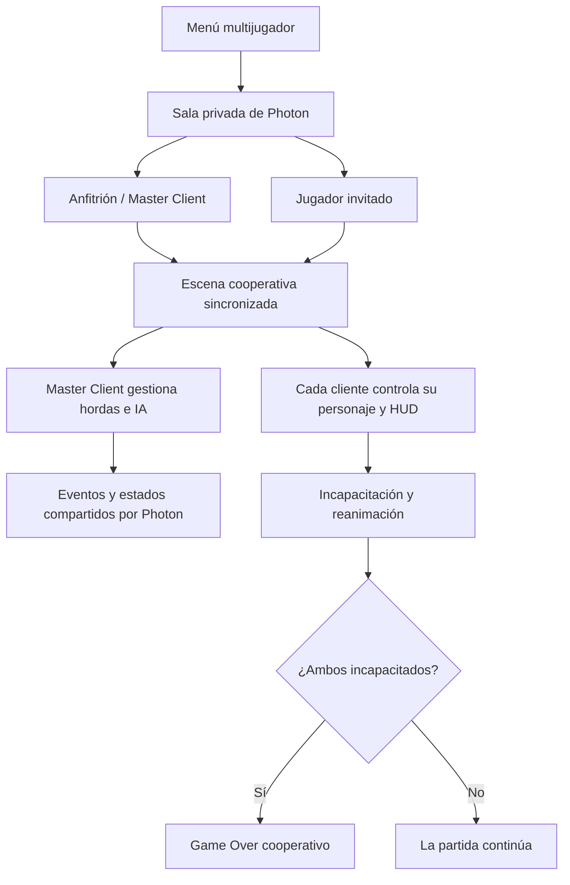

<div align="center">

# 🧟 Metro Zapata

### FPS de supervivencia zombi en México · Un jugador y cooperativo en línea

**Sobrevive a oleadas de zombis, administra tus recursos y lucha junto a otra persona para resistir el mayor tiempo posible.**

`Unity 6` · `C#` · `Photon PUN 2` · `Unity Input System` · `NavMesh` · `URP`

[Características](#-características) · [Multijugador](#-arquitectura-del-multijugador) · [Controles](#-controles) · [Instalación](#-cómo-ejecutar-el-proyecto) · [Código](#-organización-del-proyecto)

</div>

---

## 🎮 Acerca del proyecto

**Metro Zapata** es un videojuego de disparos en primera persona (FPS) y supervivencia contra zombis, ambientado en México y desarrollado en **Unity y C#** como proyecto académico en equipo. Su presentación combina referencias visuales retro/PSX con escenarios de iluminación contrastada y zonas oscuras donde la linterna resulta útil. El reto consiste en resistir oleadas de enemigos que aumentan progresivamente su dificultad, conseguir puntos mediante el combate y utilizarlos para mejorar el equipamiento y mantener al personaje con vida.

El juego cuenta con **modo individual** y **modo cooperativo en línea para dos jugadores**. La implementación cooperativa añade salas privadas mediante códigos, personajes instanciados por Photon, sincronización de enemigos y elementos interactivos, interfaces independientes por jugador y un sistema de incapacitación y reanimación.

> **Estado del proyecto:** versión académica finalizada. Este repositorio contiene el **proyecto de Unity y su código fuente**; no se presupone que incluya un instalador o un ejecutable listo para descargar.

## ✨ Características

| Sistema | Implementación |
| --- | --- |
| **Supervivencia por oleadas** | Generación progresiva de zombis, límite de enemigos simultáneos y ajustes de dificultad fácil/difícil. |
| **Enemigos con IA** | Persecución y ataques mediante `NavMeshAgent`, selección de objetivos y puntos débiles como la cabeza. |
| **Combate FPS** | Armas de fuego, machete, disparos, recarga, cargador y reserva de munición. |
| **Economía de partida** | Puntos obtenidos durante el combate y compras de armas, munición y botiquines. |
| **Salud y recuperación** | Daño, inmunidad temporal, curación con botiquín e indicadores visuales de vida. |
| **Interfaz de juego** | HUD de arma, munición, botiquines, puntuación, oleadas y estado del compañero. |
| **Interacción con el escenario** | Objetos destruibles, fragmentos físicos y efectos de impacto. |
| **Menús y ajustes** | Pausa, sensibilidad del mouse, volumen y navegación entre pantallas. |
| **Resultados de partida** | Récord local en modo individual y resultados separados de ambos jugadores en cooperativo. |

### 🧍 Modo individual

- Juega contra hordas de zombis con dificultad configurable.
- Obtén puntos, compra recursos y trata de superar tu mejor puntuación.
- Consulta el récord almacenado localmente mediante `PlayerPrefs`.

### 🤝 Modo cooperativo en línea

- **Dos jugadores** se conectan mediante una sala con **código de seis dígitos**.
- El anfitrión inicia la partida y Photon sincroniza la carga de la escena.
- Cada computadora controla exclusivamente a su personaje y presenta su **HUD local**.
- Si un jugador llega a **0 HP**, queda incapacitado, sin poder desplazarse ni atacar, pero puede seguir observando su entorno.
- Un compañero con vida puede acercarse para **reanimarlo automáticamente**; la recuperación está configurada a **30 HP**.
- Cuando **ambos jugadores están incapacitados**, se activa el **Game Over cooperativo**, con sus nombres y puntuaciones individuales.

## 🧠 Arquitectura del multijugador

El modo cooperativo utiliza **Photon PUN 2**. La lógica distribuye las responsabilidades entre el cliente propietario de cada personaje y el anfitrión (*Master Client*) para evitar que todos los equipos procesen los mismos eventos de juego.



**Decisiones técnicas principales:**

- **Propiedad del jugador (`PhotonView.IsMine`):** entrada, movimiento, cámara y elementos de interfaz asociados al jugador local.
- **Enemigos y oleadas:** el *Master Client* coordina su generación; los zombis de la sala se crean mediante `PhotonNetwork.InstantiateRoomObject`.
- **Sincronización:** RPC para comunicar eventos y `CustomProperties` para compartir estados de incapacitación, puntuaciones y fin de partida.
- **Daño y reanimación:** la vida del jugador se gestiona en su cliente propietario, con comunicación hacia los demás participantes.
- **Objetos destruibles:** el anfitrión administra su estado y notifica la destrucción para representarla en ambos clientes.
- **Escenas:** `PhotonNetwork.AutomaticallySyncScene` y `PhotonNetwork.LoadLevel` coordinan el inicio de la partida.

Esta separación permite conservar un modo individual funcional sin depender de estar conectado a una sala de Photon.

## ⌨️ Controles

Los siguientes controles de **teclado y mouse** se encuentran definidos en [`PlayerControls.inputactions`](Assets/PlayerControls.inputactions):

| Acción | Control |
| --- | --- |
| Moverse | `W` `A` `S` `D` |
| Mirar / apuntar | Mouse |
| Disparar / atacar | Clic izquierdo |
| Correr | `Shift` |
| Saltar | `Espacio` |
| Recargar | `R` |
| Cambiar entre arma principal y machete | `E` |
| Linterna | `F` |
| Usar botiquín | `T` |
| Comprar en una zona de compra | `P` |
| Pausar / reanudar | `Esc` |

> El proyecto incluye otros recursos de Input System, pero esta tabla se basa en el mapa de acciones `PlayerControls` utilizado para documentar el FPS. La reanimación cooperativa es **por proximidad** y no requiere una tecla adicional.

## 🛠️ Tecnologías

| Tecnología | Uso en el proyecto |
| --- | --- |
| **Unity `6000.5.4f1`** | Motor del videojuego (versión registrada en el repositorio). |
| **C#** | Mecánicas, IA, interacción, interfaces y lógica de red. |
| **Photon PUN 2** | Salas, propiedad de objetos, RPC y sincronización cooperativa. |
| **Unity Input System `1.19.0`** | Acciones y controles de entrada. |
| **AI Navigation `2.0.14`** | Navegación de zombis con NavMesh. |
| **Universal Render Pipeline `17.5.0`** | Renderizado del juego. |
| **TextMeshPro / Unity UI** | Menús, indicadores de vida, munición y puntuación. |
| **Blender** | Herramienta de trabajo con recursos 3D, indicada en la documentación original del proyecto. |
| **Git y GitHub + Git LFS** | Versionado del proyecto y gestión de archivos binarios pesados. |

Las versiones se obtuvieron de [`ProjectVersion.txt`](ProjectSettings/ProjectVersion.txt) y [`manifest.json`](Packages/manifest.json).

## 🚀 Cómo ejecutar el proyecto

### Requisitos

- **Unity Hub** y el editor **Unity `6000.5.4f1`**.
- **Git** y **Git LFS**, porque el repositorio almacena modelos, audio y otros recursos mediante LFS.
- Acceso a Internet para importar paquetes y utilizar el modo cooperativo.
- Para partidas en línea, una **aplicación Photon Realtime/PUN** con un **App ID propio**.

### Abrir en Unity

1. Instala Git LFS y descarga el repositorio:

   ```bash
   git lfs install
   git clone https://github.com/MauAlcantara1/Proyecto-FPS.git
   cd Proyecto-FPS
   git lfs pull
   ```

2. En **Unity Hub**, selecciona **Add project from disk** y abre la carpeta clonada.
3. Abre el proyecto con **Unity `6000.5.4f1`** y permite que termine la importación de recursos y paquetes.
4. Abre la escena [`Assets/Scenes/Menu.unity`](Assets/Scenes/Menu.unity) y ejecuta el juego desde el editor.

### Configurar el modo cooperativo

1. Configura tu App ID de Photon en el recurso `Assets/Photon/PhotonUnityNetworking/Resources/PhotonServerSettings.asset` desde Unity.
2. Asegúrate de que **ambos jugadores utilicen el mismo App ID, región y versión de juego**. La implementación del menú establece la región fija `us` en `PhotonMultijugador.cs`.
3. Ejecuta dos instancias compatibles (por ejemplo, **Editor + una compilación**).
4. En la primera instancia, crea una sala; comparte el código mostrado.
5. En la segunda, escribe el código para unirse. Cuando estén los dos jugadores, el anfitrión puede iniciar la partida.

> **Seguridad:** usa tu propio App ID de Photon y no publiques credenciales privadas. Para construir un ejecutable, revisa las escenas habilitadas en *Build Profiles / Build Settings* y genera la compilación desde Unity. Este repositorio no documenta una distribución binaria oficial.

## 📁 Organización del proyecto

```text
Proyecto-FPS/
├── Assets/
│   ├── Scenes/                   # Menú, modo individual, cooperativo y pruebas
│   ├── Resources/                # Prefabs instanciados por Photon
│   ├── scripts/
│   │   ├── Configuracion/        # Menús, salas Photon y HUD cooperativo
│   │   ├── Enemigo/              # IA y sistema de oleadas
│   │   ├── Interfaz/             # Game Over cooperativo
│   │   ├── personaje/            # Movimiento, armas, vida, puntos y compras
│   │   ├── UI/                   # Pausa y configuración
│   │   ├── ReanimacionCooperativa.cs
│   │   └── destruible.cs
│   ├── Photon/                   # SDK de Photon PUN 2
│   └── ...                       # Escenarios, modelos, sonidos y efectos
├── Packages/                     # Dependencias de Unity
├── ProjectSettings/              # Configuración del proyecto
├── .gitattributes                # Seguimiento de binarios con Git LFS
└── README.md
```

### Código destacado

| Componente | Responsabilidad |
| --- | --- |
| [`HordaManager.cs`](Assets/scripts/Enemigo/HordaManager.cs) | Oleadas, dificultad y aparición de zombis. |
| [`EnemigoController.cs`](Assets/scripts/Enemigo/EnemigoController.cs) | IA, persecución, daño y comportamiento de enemigos. |
| [`PhotonMultijugador.cs`](Assets/scripts/Configuracion/PhotonMultijugador.cs) | Conexión, salas con código, lista de jugadores y arranque de partida. |
| [`personajeController.cs`](Assets/scripts/personaje/personajeController.cs) | Movimiento, controles, pausa e interacción local. |
| [`armaController.cs`](Assets/scripts/personaje/armaController.cs) | Selección de armas, animaciones e integración del HUD. |
| [`MunicionArma.cs`](Assets/scripts/personaje/MunicionArma.cs) | Cargador, reserva, disparos y recarga. |
| [`personajeVida.cs`](Assets/scripts/personaje/personajeVida.cs) | Salud, curación, incapacidad y reanimación. |
| [`ReanimacionCooperativa.cs`](Assets/scripts/ReanimacionCooperativa.cs) | Detección de compañeros incapacitados y reanimación por proximidad. |
| [`GameOverMultijugador.cs`](Assets/scripts/Interfaz/GameOverMultijugador.cs) | Estados finales, nombres y puntuaciones en cooperativo. |
| [`destruible.cs`](Assets/scripts/destruible.cs) | Daño y destrucción de objetos del escenario. |

## 💡 Retos técnicos y aprendizajes

El desafío más significativo fue **convertir mecánicas originalmente individuales en sistemas cooperativos** sin perder el funcionamiento del modo solitario. El desarrollo requirió resolver problemas de propiedad de personajes, sincronización del movimiento, gestión de enemigos, interfaces locales, daño a distancia, reanimación y estado final compartido.

Entre los aprendizajes del proyecto destacan la depuración de eventos de Photon, la separación entre autoridad de red y presentación visual, la coordinación de estados entre clientes y la integración de sistemas de gameplay con interfaces de usuario.

## 👨‍💻 Participación y trabajo en equipo

Mi contribución se concentró especialmente en la **jugabilidad del FPS y la integración técnica**: movimiento y cámara del personaje, armas y munición, HUD, puntuación y economía, botiquines, interacción con el escenario y adaptación de varios de estos sistemas al cooperativo con Photon. También participé en la **integración del trabajo en Git**, resolución de conflictos y pruebas entre distintas instancias.

El videojuego fue desarrollado como **proyecto académico en equipo**, con otros componentes como enemigos, oleadas, dificultad, menús y ambientación trabajados de manera colaborativa. Esta división de responsabilidades hizo de la integración entre sistemas una parte central del desarrollo.

## 👥 Desarrollo y recursos

Proyecto académico desarrollado en Unity. Puedes consultar el [historial de cambios](https://github.com/MauAlcantara1/Proyecto-FPS/commits/main) y las [contribuciones del repositorio](https://github.com/MauAlcantara1/Proyecto-FPS/graphs/contributors).

El proyecto contiene **recursos de terceros** (por ejemplo, paquetes de Photon, efectos visuales, modelos y elementos de interfaz). Los derechos y condiciones de reutilización de esos recursos pertenecen a sus respectivos titulares; consulta sus licencias y términos antes de redistribuirlos.

> **Licencia:** no se identificó un archivo `LICENSE` general en la raíz del repositorio al preparar este README. La disponibilidad pública del código no implica automáticamente una licencia de reutilización.

---

<div align="center">

**Metro Zapata — Sobrevivir es difícil; hacerlo en equipo cambia las reglas.**

[Ver repositorio en GitHub](https://github.com/MauAlcantara1/Proyecto-FPS)

</div>

